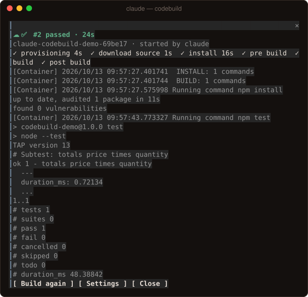

# ☁️ codebuild

> Build any repo on AWS CodeBuild without leaving Claude Code. Pick an AWS profile, press **Build**. No console, no YAML, no CI to set up.



<sub>A real session: build #1 failed, Claude read the log, fixed the code and built again through its tool. It passed in 24s, for about $0.005.</sub>

```text
☁️ Build on AWS CodeBuild
  AWS profile   [ dev ▾ ]
    ✓ account 123456789012 · us-west-2 · assumed-role/Dev/me
  Repo          [ /work/todo-api ]
    node (npm) · buildspec generated for you
    First run creates: a private S3 bucket (sources expire in 7 days), one least-privilege IAM role, one CodeBuild project.
    ~$0.005/min · small Linux machine
  [ Set up & build ]  [ Show buildspec ]  [ Close ]

☁️ ❌ #3 failed in BUILD · 1m 30s
  claude-todo-api-4f2a1c · started by claude · BUILD: COMMAND_EXECUTION_ERROR
  ✓ submitted 1s  ✓ provisioning 9s  ✓ install 12s  ✗ build 41s
  [Container] Running command npm test
  not ok 1 - adds a todo
  [ Ask Claude to fix ]  [ Build again ]  [ Settings ]  [ Close ]
  Open in the AWS console
```

The only things it needs from you are an **AWS profile** and the **repo** to build. It works out the rest.

## Features

- **One-screen setup.** `/codebuild` lists the AWS profiles you already have and shows which account, region and role each one is, before anything happens. The first build creates what it needs and tags it `created-by=claude-codebuild-mod`:
  - a private S3 bucket per region, whose uploaded sources expire after 7 days
  - one IAM role per account that can only write `claude-*` build logs and read the uploaded sources
  - one CodeBuild project per repo

  After that, `/codebuild` builds straight away.
- **Builds what you have now.** The working tree is zipped with git, uncommitted and untracked changes included. `.gitignore` is respected, and `.env` files, keys and `.npmrc`/`.netrc` are never uploaded. A subfolder of a repo works too, for monorepos. Folders that aren't git repos are zipped without `.git`, `node_modules` and secrets.
- **No buildspec needed.** If the repo has a `buildspec.yml`, it's used. Otherwise one is generated for npm, pnpm, yarn, Python, Go, Rust, Maven, Gradle, .NET, Ruby, Make or Docker, with runtime versions read from `.nvmrc` and `.python-version`. `/codebuild buildspec save` writes it into the repo.
- **Live in a pane.** Each phase shows with its time, along with a live log tail and a link to the console. The status line reads `☁️ #3 · BUILD · 1m 20s`, and a toast says when it's done and what it cost.
- **Claude can build too.** Claude has a `build` tool. Ask "make sure this passes on CodeBuild" and Claude runs it, reads the failing log lines, fixes the code and builds again. It asks you first (**Build** / **Allow this session** / **Don't build**), and refuses when nobody can be asked.
- **Ask Claude to fix.** One press on a failed build hands Claude the failing phase and the last 80 log lines.
- **Errors you can act on.** An expired SSO session tells you the `aws sso login --profile …` command to run. A missing permission names the IAM action. A missing profile or CLI says how to fix it.
- **Clean exit.** `/codebuild teardown` deletes this repo's project, log group and uploaded sources after you confirm. `teardown all` also deletes the shared role and bucket.

## Install

```shell
/plugin marketplace add Singh-AP/awesome-claude-mods
/plugin install codebuild@awesome-claude-mods
```

It needs the [AWS CLI](https://aws.amazon.com/cli/) (v2), signed in any way the CLI supports: SSO, access keys, `credential_process` or assume-role profiles.

## Commands

| Command | What it does |
| --- | --- |
| `/codebuild` | Build this repo, or open setup the first time |
| `/codebuild <path>` | The same, for another folder |
| `/codebuild setup` | Change the profile or repo |
| `/codebuild status` · `logs` · `stop` | The running build |
| `/codebuild buildspec` · `buildspec save` | See or save the generated buildspec |
| `/codebuild teardown` · `teardown all` | Delete what it created |

## Configuration

| Option | Default | What it does |
| --- | --- | --- |
| `profile` | empty | Profile for repos not set up yet. Empty: `AWS_PROFILE`, else `default` |
| `region` | empty | Empty: the profile's region, else `us-east-1` |
| `computeType` | `BUILD_GENERAL1_SMALL` | `SMALL`, `MEDIUM` or `LARGE` |
| `image` | `aws/codebuild/amazonlinux-x86_64-standard:5.0` | Image for new projects |

## What it asks your AWS identity to do

| When | Actions |
| --- | --- |
| Every build | `sts:GetCallerIdentity`, `s3:PutObject` on the bucket, `codebuild:StartBuild`, `BatchGetBuilds`, `StopBuild`, `logs:GetLogEvents` |
| First build in an account or region | `s3:CreateBucket`, `PutBucketPublicAccessBlock`, `PutLifecycleConfiguration`, `PutBucketTagging`, `iam:CreateRole`, `PutRolePolicy`, `iam:PassRole` (its own role), `codebuild:CreateProject`, `BatchGetProjects` |

## How it works

| Event | Why |
| --- | --- |
| `command.run` | `/codebuild` and its subcommands |
| `tool.call` on `mcp__codebuild__build` | Claude's tool: confirm, build, wait, report |
| `ui.render` on `Pane` | The setup screen and the live build |
| `$.process.run` | `aws` and `git` |
| `$.clock.every` | Follows a build you started (every 4 seconds) |
| `$.state`, `$.store` | The live build, and each repo's setup |

## Test it

```shell
claude plugin test mods/cloud/codebuild   # 18 tests, with the AWS CLI and git stubbed
```

## Tested for real

In a personal AWS account in us-east-1, the first build created the bucket, role and project in about 20 seconds. It ran `npm test` on CodeBuild and streamed the failure into the pane. **Ask Claude to fix** gave Claude the log; Claude fixed the code and rebuilt through the tool, and it went green.

## Limitations

- Linux x86 builds only for now. There's no ARM or Windows, and no VPC or secrets configuration.
- The cost shown is an estimate at us-east-1 on-demand prices, not your bill.
- Uploads go through the AWS CLI, so a very large repo takes as long as its upload.
- It builds what's on disk. Builds aren't triggered by pushes; use CodePipeline or GitHub Actions for that.
